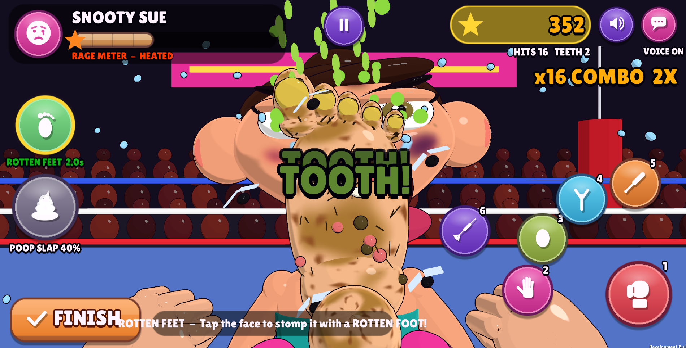
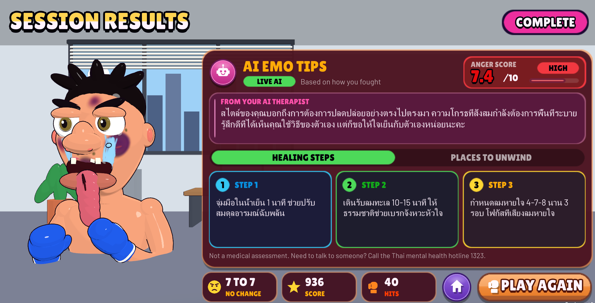
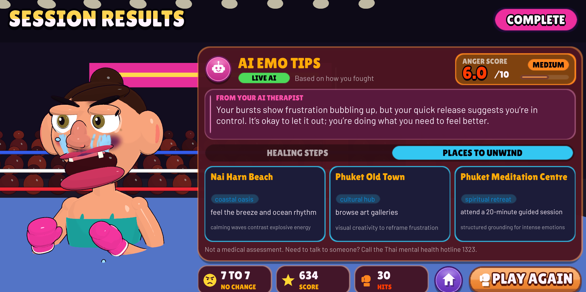
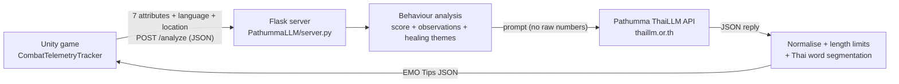

# 🥊 EmoRelief AI (Intelligent Emotional Catharsis Game)

> **Academic Project:** Group Work for Year 2 Bachelor of Engineering in Computer Engineering
>
> **Institution:** Southeast Asia University (SAU)
>
> **Course:** AI Learning and Data Science
>
> **Students:** Krisada Ratyot, Chadil Bumrungpong, Butsayamat Rattanasuanchit


---

## 🎯 Project Objective

**EmoRelief AI** is an interactive stress-relief mobile/desktop prototype designed to provide a safe, non-judgmental digital sandbox for emotional venting.

The project bridges **Data Science (Behavioral Telemetry Tracking)** and **Applied Artificial Intelligence (Large Language Models)** to:

1. Capture raw user physical interaction metrics (clicks per second, combat momentum, tool choices, and hesitation patterns) as psychological indicators.
2. Transform telemetry into structured behavioral features.
3. Utilize a Thai-centric Large Language Model (**Pathumma ThaiLLM**) to interpret emotional states, generate empathetic therapeutic feedback, and suggest personalized, actionable mental wellness activities and localized resources in Chiang Mai (or anywhere the player lives in Thailand).

---

## 📸 Screenshots

| Ready to fight | Mid-fight (Rotten Feet combo) |
| :---: | :---: |
|  |  |
| **AI EMO Tips: Thai, healing steps** | **AI EMO Tips: English, places to unwind** |
|  |  |

---

## 📑 Table of Contents

- [How the game plays](#-how-the-game-plays)
- [How the AI works](#-how-the-ai-works)
- [Quick start: play the game (no Unity needed)](#-quick-start-play-the-game-no-unity-needed)
- [Developer setup: edit and rebuild](#-developer-setup-edit-and-rebuild)
- [AI backend reference](#-ai-backend-reference)
- [Controls](#-controls)
- [Project structure](#-project-structure)
- [Troubleshooting](#-troubleshooting)
- [Credits, licences and disclaimer](#-credits-licences-and-disclaimer)

---

## 🎮 How the game plays

1. **Home**: pick the AI language (**EN / ไทย**) and type **Your Location** (city or province, Thai or English). Leaving it blank is fine.
2. **Check in (step 1/4)**: choose a mood and rate your anger from 0 to 10.
3. **Build your opponent (step 2/4)**: a fictional cartoon character. Pick the face, hair, skin, scene (Park, Bar, Bedroom, Office, Boxing gym) and a name.
4. **Fight (step 3/4)**: let it out with six tools (Punch, Slap, Egg, Slingshot, Bat, Dart), plus two ultimates: **Rotten Feet** and **Poop Slap** (charged by the rage meter). Damage builds up with bruises, tears, lost teeth and splats, and the opponent reacts with 42 voice lines.
5. **Check in again (step 4/4)**: rate your anger again.
6. **AI analysis**: a loading screen appears while the game sends your fight telemetry to the AI.
7. **Results**: the **AI EMO Tips** panel shows:
   - an **Anger Score** (Low / Medium / High) estimated from how you fought,
   - a warm **message from your AI therapist** that reflects your fighting style, without quoting any numbers,
   - **3 healing steps** that are concrete, varied and matched to your pattern,
   - **3 real places to unwind** near your location.

If the AI is unreachable, the game never hangs. It shows **OFFLINE** tips in the chosen language instead.

---

## 🧠 How the AI works



### 1. Behavioural telemetry (Data Science)

`Assets/Scripts/CombatTelemetryTracker.cs` records 7 attributes during the fight:

| # | Attribute | What it measures | Psychological reading |
|---|---|---|---|
| 1 | `total_fight_duration` | Seconds from fight start to FINISH | How long frustration has built up |
| 2 | `effective_fighting_time` | Active combo time (idle gaps excluded) | How continuously emotion is released |
| 3 | `max_attack_speed` | Peak clicks/sec in a rolling 1.5 s window | Intensity of the emotional surge |
| 4 | `max_speed_duration` | Seconds spent above 70 % of peak speed | True, lingering anger |
| 5 | `tools_used` | Hit count per tool | Concrete picture of the release |
| 6 | `primary_tool_used` | Most-used tool | Preferred style and intensity |
| 7 | `pause_tracking` | Pause/idle (>3 s) count, total time, style | Relentless release vs. restraint / overthinking |

### 2. Feature engineering

`PathummaLLM/emotion_analyzer.py` (`analyze_behaviour`) turns the raw values into:

- an **anger score (1–10)** using a weighted model of speed, focus, sustained intensity, hit force, close-range tool share, session length and restraint. The LLM may adjust it by at most ±1.0.
- **plain-language observations**, such as *"Struck in fast, explosive bursts"* or *"Paused often, as if weighing each move"*. Only these reach the LLM, so it never repeats raw game data to the player.
- **three healing themes**: one matched to the strongest pattern (e.g. physical release for high anger, reflection for restrained players), with the rest rotated so advice stays varied.

### 3. Language model (Applied AI)

The server asks **Pathumma** (via the ThaiLLM API) for empathetic, non-judgmental feedback in **English or Thai**, with strict per-field length limits. It then:

- validates the JSON and fills any missing parts,
- trims text to fit the game cards, cutting at a sentence end,
- inserts word-boundary marks into Thai text (`pythainlp`) so the game can wrap Thai lines between words.

---

## 🚀 Quick start: play the game (no Unity needed)

A ready-to-play Windows build is included in `Builds/Windows/`.

### Requirements

| Item | Version |
|---|---|
| Windows | 10 or 11, 64-bit |
| Python | 3.10 or newer (developed on **3.12.6**). Tick **"Add python.exe to PATH"** during install |
| ThaiLLM API key | Get one at [thaillm.or.th](https://thaillm.or.th) |
| Git (optional) | To clone. You can also use **Code > Download ZIP** on GitHub |

### Steps

**1. Get the project**

```powershell
git clone https://github.com/Galegalot/EmoRelief_AI.git
cd EmoRelief_AI
```

**2. Install the Python packages for the AI backend**

```powershell
python -m pip install -r PathummaLLM\requirements.txt
```

This installs `flask`, `requests`, `python-dotenv` and `pythainlp`.

**3. Add your ThaiLLM API key**

```powershell
copy PathummaLLM\.env.example PathummaLLM\.env
notepad PathummaLLM\.env
```

Replace `your-thaillm-api-key-here` with your key and save. The real `.env` file is git-ignored and must never be committed.

**4. Play**

Double-click **`Builds\Windows\EmoRelief.exe`**, or run `launcher.bat` and choose **[3] Launch Game Directly**.

You don't need to start the AI server yourself. When the game starts, it checks `http://127.0.0.1:8000/health` and, if nothing answers, launches `PathummaLLM\server.py` in a **hidden background window**. When you quit the game, it closes the server again.

> ⚠️ **Keep the folder structure as-is.** The game finds the AI backend by looking for `PathummaLLM\server.py` in the folders above `Builds\Windows\`. Moving the `Builds` folder somewhere else disables live AI, and the game falls back to offline tips.

> 💡 Want to watch the server log? Start `PathummaLLM\run_server.bat` **before** the game. The game detects the running server and reuses it.

---

## 🛠 Developer setup: edit and rebuild

### Requirements

| Tool | Version used on the dev PC |
|---|---|
| Unity Hub + **Unity 6000.3.28f1** | Install the module **Windows Build Support (Mono)** |
| Render pipeline / input | URP 17.3.0, Input System 1.20.1 (resolved automatically from `Packages/manifest.json`) |
| Python | 3.12.6 (see Quick start for packages and `.env`) |
| Editor (optional) | VS Code or Visual Studio |

### Open in Unity

1. Unity Hub → **Add → Add project from disk** → select the cloned `EmoRelief_AI` folder.
2. Open it with **Unity 6000.3.28f1**. The first open takes a few minutes while Unity rebuilds the `Library/` folder, which isn't stored in git.
3. Menu **EmoRelief → Play Prototype**, or open `Assets/Scenes/FaceLab.unity` and press **Play**.
   The characters and scenes are built at runtime, so the scene looks empty outside Play Mode.

### Fast workflow (recompile without opening Unity)

These scripts use Unity's bundled Roslyn compiler to compile `Assets/Scripts/*.cs` straight into the existing build in about 1 second. Unity must be **installed**, but it doesn't have to be open.

> **First time on a new PC:** the compiler references come from Unity's local `Library/` cache, which isn't stored in git. Open the project in Unity once and run **EmoRelief → Build Windows Demo** once. After that, `run.bat` works without opening Unity.

| Script | What it does |
|---|---|
| `run.bat` | Compile scripts into `Builds/Windows` and launch the game |
| `compile.bat` | Compile only (quick error check) |
| `launcher.bat` | Menu: compile & run, compile only, run the build, or run the automated smoke test |

If Unity is installed outside `C:\Program Files\Unity\Hub\Editor\`, set `UNITY_DIR`, for example:
`set UNITY_DIR=D:\Unity\6000.3.28f1\Editor`

> The fast workflow only updates **code**. After changing **assets** (fonts, sounds, materials, scenes), make a full build from Unity: **EmoRelief → Build Windows Demo**. This writes `Builds/Windows/EmoRelief.exe` and its data folders.
>
> **Note:** the committed build was packaged before the new Thai font (`EmoThai-Regular.ttf`) was added. Thai text displays correctly but tone marks may overlap slightly until you run **EmoRelief → Build Windows Demo** once. Play Mode in the Unity Editor already uses the new font.

### Other Unity menu items

- **EmoRelief → Validate Prototype**: automated checks (face shapes, tool damage, random styles, tips, voices, fonts).
- **EmoRelief → Configure Landscape Player**: 1600×900 resizable, landscape-only player settings.

### Thai text rendering

Unity's IMGUI text has no OpenType shaping, so Thai tone marks would collide with upper vowels.

- `tools/build_thai_font.py` builds `Assets/Resources/Fonts/EmoThai-Regular.ttf` from the Google Font **Mitr** (SIL OFL), exposing pre-positioned mark glyphs.
- `Assets/Scripts/ThaiText.cs` picks the right glyph for each syllable.

To rebuild the font (needs `pip install fonttools`):

```powershell
python tools\build_thai_font.py
```

---

## 🔌 AI backend reference

| Endpoint | Method | Purpose |
|---|---|---|
| `http://127.0.0.1:8000/health` | GET | Health check used by the game at start-up |
| `http://127.0.0.1:8000/analyze` | POST | Telemetry in → EMO Tips out |

**Request** (sent by `EmoAIClient.cs`, 25 s timeout):

```json
{
  "total_fight_duration": 135.0,
  "effective_fighting_time": 118.5,
  "max_attack_speed": 9.2,
  "max_speed_duration": 15.0,
  "tools_used": { "Punch": 160, "Slap": 85, "Bat": 30 },
  "primary_tool_used": "Punch",
  "pause_tracking": { "pause_count": 1, "total_pause_duration": 16.5, "style": "Relentless, non-stop attacker" },
  "location": "Chiang Mai",
  "language": "en"
}
```

**Response:**

```json
{
  "anger_score": 8.6,
  "player_relief_advice": "You've been holding onto a storm of frustration, letting it erupt in explosive bursts...",
  "healing_methods": ["...", "...", "..."],
  "recommended_places": [
    { "name": "...", "category": "...", "recommended_activity": "...", "reason": "..." }
  ],
  "is_fallback": false
}
```

**Testing the backend on its own:**

```powershell
cd PathummaLLM
python test_pathumma.py          # calls the LLM directly and prints the UI-ready JSON
python server.py                 # starts the API on http://127.0.0.1:8000
```

---

## ⌨️ Controls

| Input | Action |
|---|---|
| Click / tap the face | Use the current tool on that spot |
| Slingshot: press, drag back, release | Aim (the reticle moves opposite to the drag) and fire; drag length sets power |
| `1`–`6` or the round tool buttons | Punch, Slap, Egg, Slingshot, Bat, Dart |
| Foot / poop buttons (left) | **Rotten Feet** (cooldown) and **Poop Slap** (when the rage meter is full) |
| `A` / `D` / `W` / `S` / `Space` | Hit left cheek / right cheek / forehead / mouth / nose |
| `R` | Reset the face |
| `Esc` or pause button | Pause menu (resume, reset face, settings, quit to home) |
| `M` / `V` | Sound effects on/off, opponent voice on/off |
| `F2` | Phone frame on/off (presentation mode) |
| `F11` | Windowed / fullscreen |

Settings, language and location are saved between sessions.

---

## 📁 Project structure

```text
EmoRelief_AI/
├── Assets/
│   ├── Scripts/
│   │   ├── FaceLab.cs                 # Game flow, screens, input, audio, results layout
│   │   ├── CombatTelemetryTracker.cs  # Module 1: 7 telemetry attributes
│   │   ├── PythonProcessManager.cs    # Module 2: auto start/stop of the AI server
│   │   ├── EmoAIClient.cs             # Module 3: HTTP bridge + offline fallback
│   │   ├── EmoTipUIManager.cs         # Module 4: setup bar, loading screen, AI EMO Tips panel
│   │   ├── EmoSettings.cs             # Saved language + location
│   │   ├── ThaiText.cs                # Thai glyph positioning and line-break rules
│   │   ├── UiKit.cs                   # Mobile-style IMGUI widgets, text fitting and wrapping
│   │   ├── FaceCharacter.cs, FaceStyle.cs, SkinPainter.cs, MeshKit.cs   # Opponent + damage
│   │   ├── PlayerRig.cs, HandModel.cs, PropKit.cs                       # First-person arms and tools
│   │   ├── Backdrops.cs, ArtKit.cs                                      # Scenes and helpers
│   │   └── PrototypeSmokeTest.cs      # Automated end-to-end test with screenshots
│   ├── Editor/PrototypeBuilder.cs     # Setup, validation, Windows build menu items
│   ├── Resources/                     # Fonts (OFL), voice clips, materials, shader
│   └── Scenes/FaceLab.unity
├── Builds/Windows/                    # Ready-to-play build (EmoRelief.exe)
├── PathummaLLM/
│   ├── server.py                      # Flask API (/health, /analyze)
│   ├── emotion_analyzer.py            # Feature engineering + prompts + LLM call + clean-up
│   ├── test_pathumma.py               # Stand-alone LLM test
│   ├── run_server.bat                 # Start the server with a visible console
│   ├── requirements.txt
│   └── .env.example                   # Copy to .env and add your API key
├── tools/
│   ├── fast_build.ps1                 # Used by run.bat / compile.bat / launcher.bat
│   └── build_thai_font.py             # Builds EmoThai-Regular.ttf from Mitr
├── Image/                             # README screenshots
├── Packages/, ProjectSettings/        # Unity project configuration
├── run.bat, compile.bat, launcher.bat
└── message.txt                        # Original design brief
```

---

## 🩺 Troubleshooting

| Symptom | Fix |
|---|---|
| Results show an orange **OFFLINE** badge | The AI server wasn't reachable. Check that: Python is on PATH (`python --version`); you ran `pip install -r PathummaLLM\requirements.txt`; `PathummaLLM\.env` exists and holds a valid key; and port 8000 isn't used by another app. Run `PathummaLLM\run_server.bat` to see the error. |
| Loading takes ~10–20 s | Normal: the LLM is generating. After 25 s the game shows offline tips automatically. |
| Windows SmartScreen blocks `EmoRelief.exe` | Click **More info → Run anyway** (the build isn't code-signed). |
| `run.bat` says it can't find Unity | Install Unity 6000.3.28f1 through Unity Hub, or set `UNITY_DIR` (see above). |
| `run.bat` fails with missing `Library/...` references | On a fresh clone, open the project in Unity once and run **EmoRelief → Build Windows Demo** once. |
| Thai lines break in odd places | Install `pythainlp` (part of `requirements.txt`) so the server can mark word boundaries. |
| Thai tone marks overlap in the `.exe` | Rebuild once with **EmoRelief → Build Windows Demo** (see the note in Developer setup). |

---

## 📜 Credits, licences and disclaimer

- **AI model:** Pathumma (ThaiLLM), accessed through the [ThaiLLM API](https://thaillm.or.th).
- **Fonts (SIL Open Font License 1.1):** Lilita One, Barlow, Barlow Condensed and *EmoRelief Thai* (a renamed, modified build of Google Font **Mitr**). The licence texts are in `Assets/Resources/Fonts/`.
- **Voices:** generated with Windows text-to-speech.
- **Thai NLP:** [PyThaiNLP](https://github.com/PyThaiNLP/pythainlp) for word segmentation.

> **Disclaimer:** EmoRelief AI is an academic prototype. The anger score and tips are **not a medical or psychological assessment**. The opponent is fictional, and the game doesn't encourage real-world violence. If you're struggling, please talk to someone you trust or call the **Thai Department of Mental Health hotline 1323** (24 hours, free).
